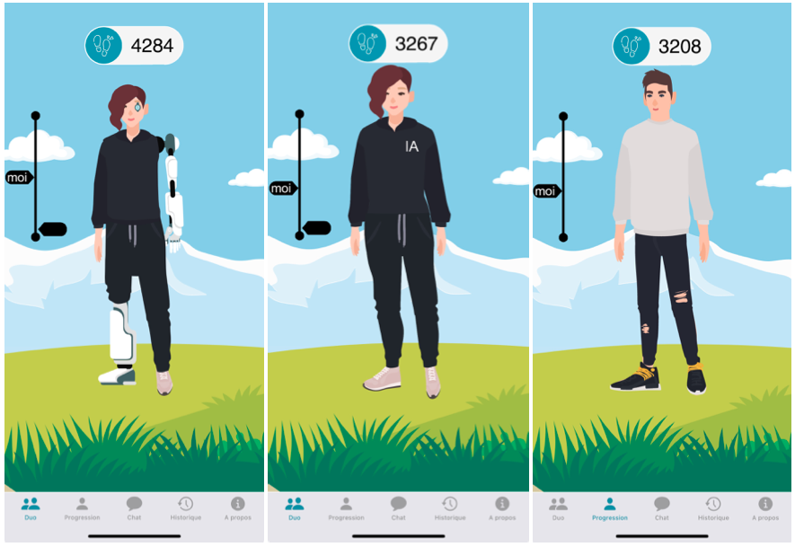

# Excero

Excero is the research platform behind a six-month randomized controlled trial (N = 280) on physical activity, in which participants pursued a weekly step goal alone, with a human peer, or with an AI-driven *simulated exercising peer* (SEP). This repository contains the source code of the platform as it was used in the study.

> **If you use this software, please cite the paper.** See [Citation](#citation).
>
> Alessandro Silacci, Mauro Cherubini, Arianna Boldi, Amon Rapp, and Maurizio Caon. 2026. *When Workout Buddies Are Virtual: AI Agents and Human Peers in a Longitudinal Physical Activity Study.* CHI '26. https://doi.org/10.1145/3772318.3790303



## Contents

- [Overview](#overview)
- [Study conditions](#study-conditions)
- [Architecture](#architecture)
- [Repository structure](#repository-structure)
- [Getting started](#getting-started)
- [Configuration](#configuration)
- [Data and analysis materials](#data-and-analysis-materials)
- [Reusing the platform in your own study](#reusing-the-platform-in-your-own-study)
- [Citation](#citation)
- [License](#license)
- [Acknowledgments](#acknowledgments)
- [Contact](#contact)

## Overview

Participants install the iOS app, which reads their daily step count from Apple HealthKit and tracks progress toward a goal of 70,000 steps per week. Depending on the study condition, the app also pairs the participant with a peer (another participant, or an AI peer) whose progress they can see and with whom they can chat.

Main features of the app:

- **Avatar onboarding**: participants personalize a cartoon-style avatar when they join.
- **Progression view**: the participant's avatar and progress toward the weekly step goal.
- **Duo view**: the peer's avatar and progress toward the daily goal (peer conditions only). Exact step counts of the peer are not shown.
- **Chat view**: free-text messaging with the peer, with a button to report inappropriate behavior (peer conditions only).
- **History view**: daily step counts grouped by week, with a trophy for each week the goal was met.
- **Status view**: shown outside the deployment phase, with the sync status.
- **Push notifications**: new chat messages, and a reminder to sync after seven days without opening the app.

The AI peer, is driven by a large language model (OpenAI GPT-4o in the study):

- **Simulated activity**: The AI peer logs its own steps every hour. The prompt includes the participant's recent step counts so that it stays challenging without being discouraging.
- **Chat**: The AI peer replies when the participant writes, and sends a message on its own at 1:00 PM if there was no exchange in the previous 24 hours. Chat prompts include the username, the current day and the participant's step progress.

## Study conditions

| Code | Condition | Peer | Duo view and chat |
|------|-----------|------|-------------------|
| CON  | Control | None | No |
| HUM  | Human peer | Another participant | Yes |
| SEPH | AI peer, human-like avatar | Alex | Yes |
| SEPC | AI peer, cyborg avatar | Alex | Yes |

After the deployment phase, the social features are disabled and only step collection continues.

## Architecture

The platform has three parts:

| Part | Technology | Role |
|------|------------|------|
| Mobile app | iOS (Swift + UIKit, minimum iOS version) | Participant-facing app: HealthKit step sync, progress views, chat |
| Backend | Django (Python3.11 and Django4.0.6, MySQL8+) | API, data management, researcher dashboard, integration with OpenAI and Firebase Cloud Messaging |
| SEP | Go (1.23) | Scheduled jobs, the AI peer's hourly step generation, messaging |

Requests were essentially done through REST requests between all the modules.

External services used:

- **Apple HealthKit**: source of daily step counts on the participant's iPhone.
- **OpenAI API**: generates AI peer's chat messages and simulated step counts.
- **Firebase Cloud Messaging**: push notifications.

User identifiers sent to third-party services are encrypted, and study data is stored pseudonymized.

## Repository structure

```
.
├── excero-ios/            # iOS app (Xcode project)
├── excero-backend/        # Django backend and researcher dashboard
├── excero-sep/            # Go component
├── CITATION.cff
├── LICENSE
├── NOTICE
└── README.md
```

## Getting started

### Prerequisites

- macOS with latest Xcode version, and an Apple Developer account (HealthKit and push notifications need one)
- Python 3.11
- Go 1.23
- MySQL 8 or above database
- An OpenAI API key
- A Firebase project with Cloud Messaging enabled

### Backend

You will need to setup environment variables before starting the backend.

```bash
cd excero-backend
python -m venv .venv && source .venv/bin/activate
pip install -r requirements.txt
python manage.py migrate
python manage.py createsuperuser
python manage.py runserver
```

### Go component

```bash
cd excero-sep
go build ./...
./<binary>
```

### iOS app

1. Create a new iOS project in Xcode.
2. Import the code.
3. Set your own team and bundle identifier under *Signing & Capabilities*.
4. Set the address of your backend in `utilities/Constants.swift`.
5. Add your own `GoogleService-Info.plist` from your Firebase project.
6. Build and run on a physical iPhone (HealthKit step data is limited in the simulator).

## Configuration

No credentials are included in this repository. You need to provide your own.

| Setting | Used by | Description |
|---------|---------|-------------|
| `DJANGO_SECRET_KEY` | Backend | Django secret key |
| `DATABASE_URL` | Backend | Database connection |
| `ALLOWED_HOSTS` | Backend | Host names the backend answers to |
| `OPENAI_API_KEY` | Backend / Go | OpenAI API key for the AI peer |
| `OPENAI_MODEL` | Backend / Go | Model name (the study used GPT-4o) |
| `FIREBASE_CREDENTIALS` | Backend / Go | Service account for Firebase Cloud Messaging |
| `API_BASE_URL` | iOS app | Address of the backend |

The full set of prompts is also provided in the paper's supplementary material.

## Data and analysis materials

This repository contains the platform's source code only. It does not contain any participant data.

## Reusing the platform in your own study

- **Ethics**: the platform collects health-related data (step counts) and chat messages. Obtain approval from your own ethics committee and informed consent from your participants before deploying it.
- **Third-party services**: messages and step data are sent to the LLM provider to generate the AI peer's behavior. Check that this is compatible with your data protection requirements.
- **Oversight**: in the original study, researchers reviewed all chat transcripts weekly for accuracy and safety.
- **Language**: the original study was conducted in French.
- **Costs**: running the AI peer makes hourly calls to the LLM API for each participant in an AI condition.

## Citation

If you use this software, or software derived from it, in academic work, please cite:

```bibtex
@inproceedings{silacci2026workout,
  author    = {Silacci, Alessandro and Cherubini, Mauro and Boldi, Arianna and Rapp, Amon and Caon, Maurizio},
  title     = {When Workout Buddies Are Virtual: AI Agents and Human Peers in a Longitudinal Physical Activity Study},
  booktitle = {Proceedings of the 2026 CHI Conference on Human Factors in Computing Systems},
  series    = {CHI '26},
  year      = {2026},
  location  = {Barcelona, Spain},
  publisher = {Association for Computing Machinery},
  address   = {New York, NY, USA},
  articleno = {1172},
  numpages  = {20},
  isbn      = {9798400722783},
  doi       = {10.1145/3772318.3790303},
  url       = {https://doi.org/10.1145/3772318.3790303}
}
```

You can also use the "Cite this repository" button on GitHub, which reads [`CITATION.cff`](CITATION.cff).

## License

This project is licensed under the Apache License 2.0. See [`LICENSE`](LICENSE) and [`NOTICE`](NOTICE).

Third-party dependencies remain under their own licenses.

## Acknowledgments

This work was supported by the University of Lausanne HEC Research Fund, the R&D Fund of the School of Management Fribourg, and the Réseau de Compétence HES-SO (RCSO) Economie & Management through the SEP4PA project. The School of Engineering and Architecture of Fribourg provided the App Store license, and Labex at the University of Lausanne supported participant coordination.

The study was approved by the Internal Review Board of the Faculty of Business and Economics at the University of Lausanne.

## Contact

[Alessandro Silacci](mailto:silacci.alessandro@gmail.com)
